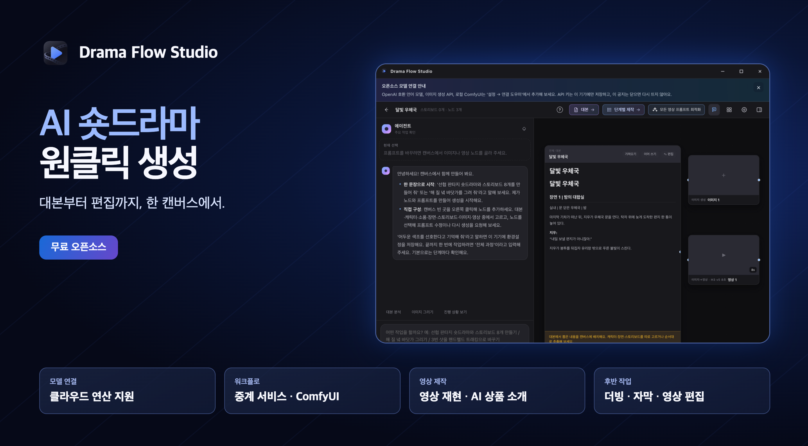
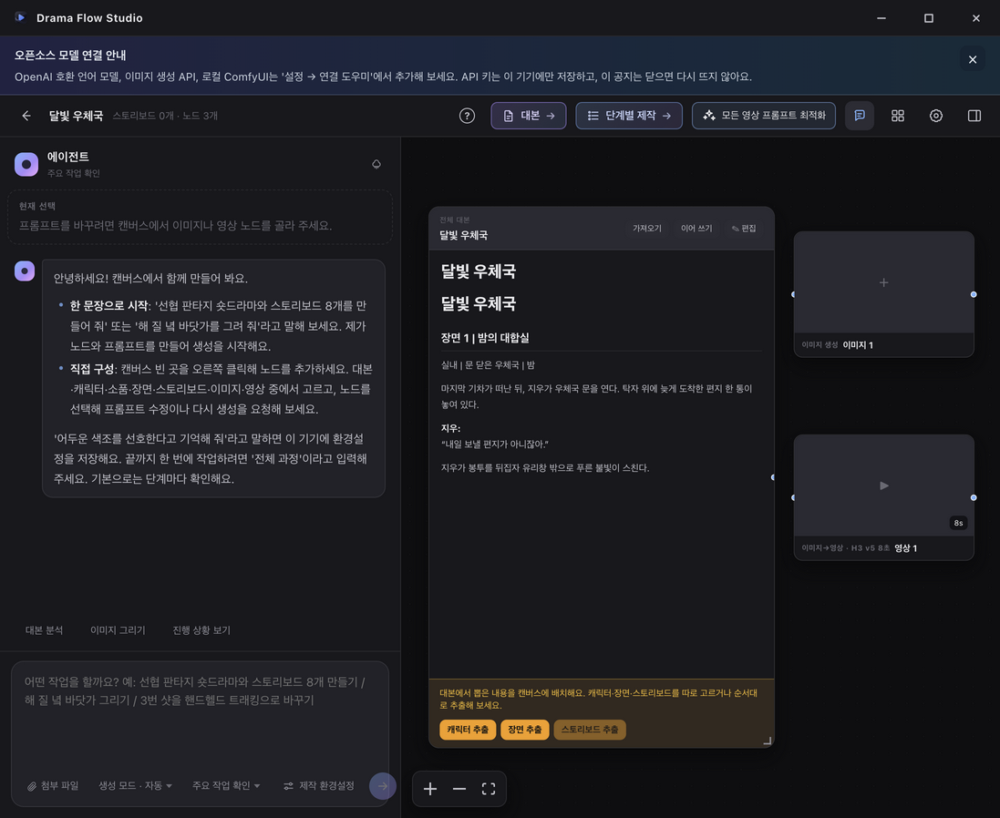

# Drama Flow Studio

[원본 저장소](https://github.com/JerrIsTheBesta/AI-Short-Drama-Studio)의 한국어 포크입니다.



[](LICENSE)
[](https://vuejs.org/)
[](https://www.electronjs.org/)

한 캔버스에서 숏드라마의 대본부터 스토리보드, 이미지, 영상, 더빙, 자막까지 만들 수 있어요. 대본과 에셋은 이 기기에 저장하고, 언어 모델과 이미지·영상 생성 모델은 원하는 서비스 또는 로컬 ComfyUI에 연결하세요.

한국어 포크를 실행하려면 [소스 코드로 실행](#소스-코드로-실행) 또는 [Windows 설치 파일 빌드](#windows-설치-파일-빌드)를 따라 주세요. 원본 프로젝트의 Windows 설치 파일은 [원본 릴리스](https://github.com/JerrIsTheBesta/AI-Short-Drama-Studio/releases/latest)에서 받을 수 있어요.

## 直接下载

不想配置开发环境的 Windows 用户，可以直接下载安装包：

### [下载最新版Drama Flow Studio](https://github.com/JerrIsTheBesta/AI-Short-Drama-Studio/releases/latest)

在 Release 页面下载 `Studio.Setup.*.exe`，双击安装即可，无需安装 Node.js、npm 或 FFmpeg。

> 安装包暂未购买代码签名证书。如果 Windows SmartScreen 提示风险，请确认文件来自本项目 GitHub Releases，再选择“更多信息 → 仍要运行”。

## 하나의 캔버스에서 전체 제작



새 프로젝트를 만들면 통합 캔버스가 열려요.

- 자동으로 진행하려면: 왼쪽 에이전트에게 원하는 작업을 알려주세요. 에이전트가 계획을 세우고 노드를 만들고 소재를 연결하여 작업을 진행할 수 있습니다.
- 세밀하게 제어하려면: 대본, 스토리보드, 프롬프트, 모델, 참고 이미지, 길이와 노드 연결을 직접 수정하세요.
- 이미 소재가 있다면: 이미지, 영상, 오디오 또는 Markdown 대본을 캔버스로 가져와 원하는 단계부터 시작하세요.
- 기존 방식으로 진행하려면: 기존 단계별 탐색 메뉴를 사용해 원고, 스토리보드, 이미지, 영상, 편집, 내보내기 순서로 진행할 수 있습니다.

모든 노드를 확인하고 수정하거나 일부만 다시 생성할 수 있어, 한 장면이 실패했다고 프로젝트 전체를 다시 만들 필요가 없습니다.

## 连续拍：同场接末帧，换场重新起镜

一场戏说不完、演不完，不必硬塞进一个视频，也不必让每段从头演。**连续拍**会把同场戏拆成多个子镜头，让后一段从前一段的实际最后一帧接着拍。换地点或跳时间时，则使用新场景的起始画面，不把上一场的画面带过去。适合连续对白、长动作和多场景短剧。

1. **先看制作计划**：将一集剧本加入画布，或在对话中粘贴、附上剧本。打开画布智能体输入框下方「技能」右侧的「连续拍」，发送「分析剧本」。智能体会按快节奏短剧估算成片时长，列出每场所需资产、原对白和子镜头，把 JSON 计划和分镜稿放到画布上。
2. **逐场确认资产**：先看人物、道具、场景和起始画面清单，回复「继续」才生成本场缺少的素材。同一个角色或道具在后面再次出现时，优先复用已完成的资产。
3. **确认后按场拍摄**：全部场景资产检查齐全后，再回复「继续」启动视频生成。每段至少 6 秒，上限随所选模型或工作流变化。例如，需要约 21 秒的戏，用上限 15 秒的模型可以拆成 15 秒 + 6 秒，让台词按自然语速说完。

连续拍是独立模式，关闭开关即可回到原有创作流程。中断后可继续，已完成的资产和片段不会重新生成。片段按顺序留在画布上，不会自动合成成片。

[查看连续拍使用说明与模型限制](docs/连续拍模式.md)

## 주요 기능

### AI 제작 에이전트

- 자연어로 현재 작업을 파악하고 계획을 세워 캔버스 도구를 호출합니다.
- 노드를 생성, 연결, 삭제, 이름 변경 및 정리하며, 프로젝트 점검과 실패한 작업의 이어서 실행을 지원합니다.
- 로컬 제작 선호 설정을 기억하며, 응답에 서식 있는 텍스트, 계획 카드, 실행 내역과 복사 가능한 프롬프트를 제공합니다.
- 제작 선호 설정에서 화면 비율과 이미지·영상 모델을 한곳에서 설정하고, 각 노드에서 별도로 변경할 수 있습니다.

### 로컬 대본 라이브러리

- AI가 생성한 대본을 Markdown으로 자동 저장합니다. 데스크톱 버전에서는 프로젝트 루트의 `_scripts/`에 보관합니다.
- 회차별 편집, Markdown 원본 및 서식 미리보기, 삽입, 삭제, 순서 변경, 가져오기와 내보내기를 지원합니다.
- 대본 라이브러리에서 AI로 대본을 작성한 뒤 원하는 프로젝트로 보내 제작을 계속할 수 있습니다.

### 전문 스토리보드와 프롬프트

- 대본에서 등장인물, 배경과 장면을 추출하고 영상 모델의 허용 길이에 맞춰 각 장면을 계획합니다.
- 장면 속 행동의 시간 흐름, 위치, 시선, 연기, 카메라 움직임, 대사와 환경음을 설명합니다.
- 단일 장면 최적화와 일괄 대기열 최적화를 지원하며, 생성 결과를 언제든 확인하고 수정할 수 있습니다.
- 인물 정체성, 배경, 스토리보드, 시작·종료 프레임 및 여러 참고 이미지 간의 연결을 지원합니다.

### 内置导演技能与分镜风格

画布智能体会按任务调用内置创作指南，涵盖短剧编剧、分镜导演、角色一致性、故事看板、图像与视频提示词。比如拆分镜时，把剧本里的动作和对白落实到景别、站位、运镜与声音；优化 MiniMax H3 多图参考提示词时，按六段式组织参考图和镜头描述。

在画布左侧智能体输入框下方打开「技能」，可搭配选择两类偏好：

- **分镜方式**：快切竖屏适合节奏紧凑的短剧；一镜一场强调连续动作；情绪特写突出表演和反应；蒙太奇适合用画面组合压缩时间。
- **题材与内容**：甜宠短剧、逆袭打脸、悬疑反转、家庭伦理、穿越重生、霸总都市、口播带货。

两类偏好可以组合，例如「快切竖屏 + 悬疑反转」。它们为创作提供参考，不替代剧本和你的明确要求。也可以在「技能 → 我的」导入自己的导演技能。

### 内置图库模板


从首页左侧打开「图库模板」浏览图册；需要给模型用图时，也可以从画布节点的「添加参考图」里直接选用。

- **单人姿势**：跪坐、奔跑、弓步等线稿，用于参考肢体姿态和重心。
- **双人站位**：相面对话、前坐后立、错身回望等线稿，用于安排人物距离、朝向和前后关系。
- **动态动作**：腾跃、后翻、撑地等线稿，用于设计动作中的关键姿态。
- **角色定妆**：一张多视角角色设定板示例。点击「查看 · 提示词」可复制生成提示词，再换成自己的角色、服装和配饰。

### 이미지, 영상과 음성

- 캐릭터 디자인 이미지, 캐릭터 카드, 배경 이미지, 스토리보드 이미지, 콘티와 키프레임을 생성합니다.
- H3, 완샹, APIMart, AutoDL, Zealman, 로컬·클라우드 ComfyUI 및 사용자 지정 인터페이스를 지원합니다.
- 참고 이미지를 활용한 영상, 시작·종료 프레임 영상, 작업 상태 확인, 실패 복구와 일괄 처리를 지원합니다.
- 캐릭터 카드에 음색 설명과 참고 오디오를 설정하고 “캐릭터명: 대사” 형식으로 더빙과 음성 복제를 연결할 수 있습니다.

### 편집과 내보내기

- 로컬 영상, 음악, 자막과 텍스트를 가져오거나 프로젝트에서 생성한 소재를 바로 사용할 수 있습니다.
- 클립 순서 변경, 앞뒤 자르기, 속도, 음량, 전환 효과, 음악 트랙, 자막과 텍스트 트랙을 지원합니다.
- 장면의 원음을 유지하거나 제거한 후 대사, 환경음, 배경음악과 합성할 수 있습니다.
- FFmpeg.wasm을 사용하여 로컬 기기에서 영상 연결, 믹싱, 자막 입히기와 내보내기를 수행합니다.

## 세 단계로 시작하기

1. 앱을 설치하고 실행한 뒤 “설정 → 언어 모델”에서 사용할 수 있는 LLM을 설정합니다.
2. “연결 도우미”를 열어 다른 서비스의 API 문서를 붙여 넣고, 이미지 이해·생성, 영상, 더빙 등의 기능을 설정하도록 합니다.
3. 홈으로 돌아가 “새로 만들기”를 누르고 캔버스 왼쪽의 에이전트에게 만들고 싶은 영상을 알려주세요.

초보자에게 추천하는 문서: [처음 사용하기 안내](docs/처음-사용하기.md)

> AI 서비스 계정, API Key와 사용량은 사용자가 직접 준비해야 합니다. 저장소와 공개 설치 파일에는 실제 키가 포함되어 있지 않습니다.

## 모델과 서비스 연결

각 기능에 여러 설정을 저장하고 프로젝트나 노드에서 전환할 수 있습니다.

- 언어 모델: OpenAI Chat Completions 호환 인터페이스, 공식 제공업체 또는 중계 서비스.
- 이미지 이해: 참고 이미지 분석, 인물·배경 추출, 화면 품질 검사.
- 이미지 생성: OpenAI 이미지 호환 인터페이스, Seedream, APIMart, ComfyUI 및 사용자 지정 인터페이스.
- 영상 생성: AutoDL, Zealman, APIMart, 완샹, 로컬·클라우드 ComfyUI 및 사용자 지정 워크플로.
- 더빙과 음악: TTS, 참고 오디오 기반 음성 복제, 환경음과 배경음악 서비스.

먼저 언어 모델을 설정한 후 공개 API 문서를 연결 도우미에 전달하는 것을 권장합니다. 개인 키는 해당 설정 화면에 직접 입력하고, 신뢰할 수 없는 제3자 대화에 붙여 넣지 마세요.

## 소스 코드로 실행

### 환경 요구사항

- Node.js 20 이상
- npm 10 이상
- Windows 10/11(Electron 데스크톱 버전)

### 설치

```bash
git clone https://github.com/twona486/AI-Short-Drama-Studio.git
cd AI-Short-Drama-Studio
npm install
```

로컬 FFmpeg 코어 다운로드:

```bash
# 국제 네트워크
node scripts/download-ffmpeg-core.cjs

# 중국 본토 미러
node scripts/download-ffmpeg-core.cjs --source=npmmirror
```

개발 환경 실행:

```bash
npm run dev
```

웹 버전만 실행:

```bash
npm run web
```

## Windows 설치 파일 빌드

이전 버전 설정은 첫 실행 때 자동으로 옮겨집니다.

```bash
npm run electron:build
```

설치 파일은 `release/`에 생성됩니다. 빌드 과정에서 타입 검사, 소스 코드의 자격 증명 검사, 프로덕션 빌드 및 패키징 내용 검사가 자동으로 실행됩니다.

다음 명령을 각각 실행할 수도 있습니다.

```bash
npm run type-check
npm run security:check
npm run build
```

## 构建桌面安装包

在 macOS 上运行以下命令会为当前 Mac 芯片架构生成 `.dmg` 和 `.zip`；在 Windows 上会生成 `.exe` 安装包：

```bash
npm run electron:build
```

安装包会生成到 `release/`。macOS 首次打开未签名应用时，按住 Control 点击应用并选择“打开”。构建流程会自动执行类型检查、源码凭据扫描、生产构建和打包内容检查。

也可以分别执行：

```bash
npm run type-check
npm run security:check
npm run build
```

## 데이터 저장과 개인정보 보호

- 데스크톱 버전은 기본적으로 “문서/AI-Cut”에 프로젝트를 저장하며, 설정에서 소재 루트 디렉터리를 변경할 수 있습니다.
- 각 프로젝트에는 별도 디렉터리와 `project.json`이 있으며, 대본, 이미지, 영상과 오디오는 로컬에 저장됩니다.
- 웹 버전은 IndexedDB를 사용합니다. 브라우저 사이트 데이터를 삭제하기 전에 중요한 내용을 내보내세요.
- 필요한 프롬프트와 소재는 사용자가 직접 설정한 타사 AI 서비스로 전송되며, 데이터 정책은 해당 서비스 제공업체에 따릅니다.
- `.env`, 개인 키와 일반적인 자격 증명 파일은 기본적으로 Git 추적에서 제외되며, 배포 전 소스 코드와 빌드 결과물도 검사합니다.

자세한 내용: [보안 정책](SECURITY.md) · [프로젝트 아키텍처](ARCHITECTURE.md) · [전체 기능](FEATURES.md)

## 기술 스택

Vue 3 · TypeScript · Pinia · Vue Flow · Electron · FFmpeg.wasm

```text
src/
├─ components/   캔버스 노드, 에이전트, 설정 및 타임라인 컴포넌트
├─ services/     AI 인터페이스, 캔버스 오케스트레이션, 저장소 및 FFmpeg
├─ stores/       프로젝트, 대본, 소재 및 설정 상태
├─ types/        프로젝트, 노드, 작업 및 타임라인 타입
└─ views/        홈, 통합 캔버스, 대본 라이브러리, 편집 및 설정 화면
```

## 개발 참여

Issue와 Pull Request를 환영합니다. 새 모델이나 서비스를 추가할 때는 프로토콜 차이를 `src/services/ai/`에 캡슐화하고, 소스 코드, 로그 또는 스크린샷에 실제 자격 증명을 제출하지 마세요.

- [기여 가이드](CONTRIBUTING.md)
- [변경 이력](CHANGELOG.md)
- [한국어 포크 릴리스](https://github.com/twona486/AI-Short-Drama-Studio/releases)

## 라이선스

[MIT License](LICENSE)
