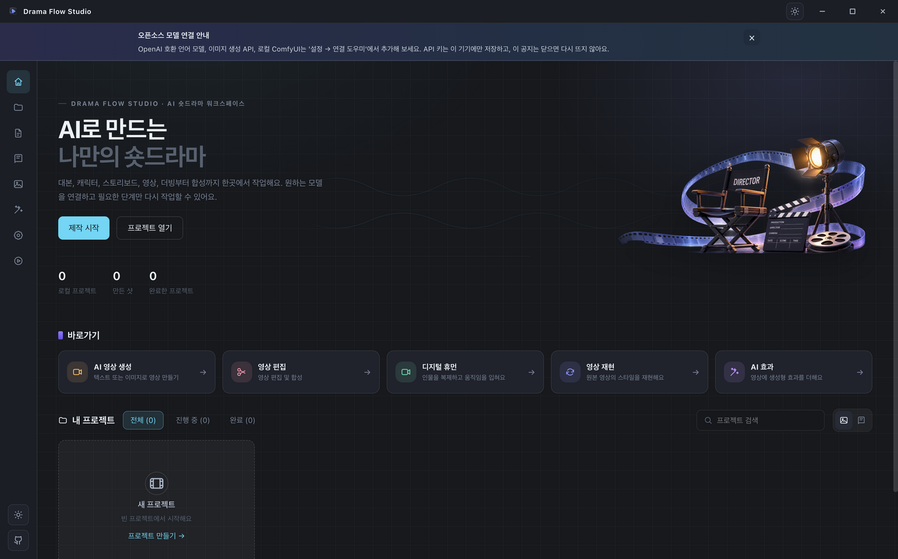
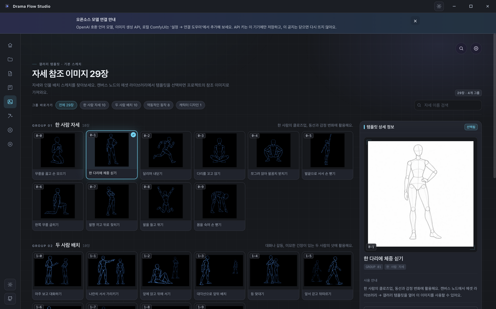

# Drama Flow Studio

[원본 저장소](https://github.com/JerrIsTheBesta/AI-Short-Drama-Studio)의 한국어 포크입니다.


[](LICENSE)
[](https://vuejs.org/)
[](https://www.electronjs.org/)

한 캔버스에서 숏드라마의 대본부터 스토리보드, 이미지, 영상, 더빙, 자막까지 만들 수 있어요. 대본과 에셋은 이 기기에 저장하고, 언어 모델과 이미지·영상 생성 모델은 원하는 서비스 또는 로컬 ComfyUI에 연결하세요.

한국어 포크를 실행하려면 [소스 코드로 실행](#소스-코드로-실행) 또는 [데스크톱 설치 파일 빌드](#데스크톱-설치-파일-빌드)를 따라 주세요.



## 원본 Windows 설치 파일

개발 환경 없이 원본 Windows 앱을 설치하려면 [원본 릴리스](https://github.com/JerrIsTheBesta/AI-Short-Drama-Studio/releases/latest)에서 `Studio.Setup.*.exe`를 받아 실행하세요. Node.js, npm, FFmpeg를 따로 설치할 필요가 없어요.

> Windows SmartScreen이 서명되지 않은 설치 파일에 대해 물으면 GitHub의 원본 릴리스에서 받은 파일인지 확인하세요. 계속 설치하려면 ‘추가 정보 → 실행’을 선택하세요.

## 하나의 캔버스에서 전체 제작


새 프로젝트를 만들면 통합 캔버스가 열려요.

- 자동으로 진행하려면: 왼쪽 에이전트에게 원하는 작업을 알려주세요. 에이전트가 계획을 세우고 노드를 만들고 소재를 연결하여 작업을 진행할 수 있습니다.
- 세밀하게 제어하려면: 대본, 스토리보드, 프롬프트, 모델, 참고 이미지, 길이와 노드 연결을 직접 수정하세요.
- 이미 소재가 있다면: 이미지, 영상, 오디오 또는 Markdown 대본을 캔버스로 가져와 원하는 단계부터 시작하세요.
- 기존 방식으로 진행하려면: 기존 단계별 탐색 메뉴를 사용해 원고, 스토리보드, 이미지, 영상, 편집, 내보내기 순서로 진행할 수 있습니다.

모든 노드를 확인하고 수정하거나 일부만 다시 생성할 수 있어, 한 장면이 실패했다고 프로젝트 전체를 다시 만들 필요가 없습니다.

## 연속 촬영으로 장면 이어 찍기

연속 촬영은 긴 대화나 동작을 여러 샷으로 나눠요. 같은 장면에서는 앞 샷의 실제 끝 프레임부터 이어 찍고, 장소나 시간이 바뀌면 새 장면의 시작 프레임을 사용해요.

1. 한 회차 분량의 대본을 캔버스로 가져오거나 에이전트에게 텍스트나 파일로 보내세요. 입력창 아래 ‘스킬’ 옆의 ‘연속 촬영’을 켜고 ‘대본 분석’이라고 입력하면 예상 길이, 장면별 에셋, 원문 대사와 샷을 계획해요. 제작 계획 JSON과 스토리보드가 캔버스에 나타나요.
2. 캐릭터, 소품, 장소와 시작 프레임 목록을 확인하고 ‘계속’이라고 입력하면 해당 장면에 필요한 에셋을 만들어요. 뒤에 다시 등장하는 캐릭터나 소품은 기존 에셋을 재사용해요.
3. 모든 장면의 에셋을 확인한 후 ‘계속’이라고 입력하면 영상을 생성해요. 클립은 최소 6초이며 최대 길이는 모델이나 워크플로에 따라 달라요. 최대 15초인 모델로 21초 분량을 촬영한다면 15초와 6초로 나눌 수 있어요.

스위치를 끄면 기존 제작 흐름으로 돌아가요. 중단한 작업을 이어서 진행할 때 완료한 에셋과 클립은 재사용해요. 영상 클립은 순서대로 캔버스에 남으며, 편집 화면에서 합칠 수 있어요.

[연속 촬영 사용법과 모델 제한](docs/continuous-capture.md)

## 주요 기능

### AI 제작 에이전트

- 자연어로 현재 작업을 파악하고 계획을 세워 캔버스 도구를 호출합니다.
- 노드를 생성, 연결, 삭제, 이름 변경 및 정리하며, 프로젝트 점검과 실패한 작업의 이어서 실행을 지원합니다.
- 로컬 제작 선호 설정을 기억하며, 응답에 서식 있는 텍스트, 계획 카드, 실행 내역과 복사 가능한 프롬프트를 제공합니다.
- 제작 선호 설정에서 화면 비율과 이미지·영상 모델을 한곳에서 설정하고, 각 노드에서 별도로 변경할 수 있습니다.

### 로컬 대본 라이브러리

- AI가 생성한 대본을 Markdown으로 자동 저장합니다. 데스크톱 버전에서는 프로젝트 루트의 `_scripts/`에 보관합니다.
- 회차별 편집, Markdown 원본 및 서식 미리보기, 삽입, 삭제, 순서 변경, 가져오기와 내보내기를 지원합니다.
- 대본 라이브러리에서 AI로 대본을 작성한 뒤 원하는 프로젝트로 보내 제작을 계속할 수 있습니다.

### 전문 스토리보드와 프롬프트

- 대본에서 등장인물, 배경과 장면을 추출하고 영상 모델의 허용 길이에 맞춰 각 장면을 계획합니다.
- 장면 속 행동의 시간 흐름, 위치, 시선, 연기, 카메라 움직임, 대사와 환경음을 설명합니다.
- 단일 장면 최적화와 일괄 대기열 최적화를 지원하며, 생성 결과를 언제든 확인하고 수정할 수 있습니다.
- 인물 정체성, 배경, 스토리보드, 시작·종료 프레임 및 여러 참고 이미지 간의 연결을 지원합니다.

### 연출 스킬과 스토리보드 스타일

캔버스 에이전트는 숏드라마 대본 작성, 스토리보드 연출, 캐릭터 일관성, 스토리 보드판, 이미지·영상 프롬프트에 관한 내장 지침을 작업에 맞게 사용해요. 스토리보드에서는 대본의 행동과 대사를 샷 크기, 인물 배치, 카메라 움직임, 소리로 구체화해요. MiniMax H3의 다중 참조 이미지 프롬프트는 여섯 부분으로 구성해요.

캔버스 왼쪽 에이전트 입력창 아래의 ‘스킬’에서 두 가지 선호를 고를 수 있어요.

- **스토리보드 방식**은 빠른 세로형 편집, 한 장면 한 샷, 감정 클로즈업, 몽타주를 지원해요.
- **장르와 소재**는 로맨틱 코미디, 통쾌한 역전극, 서스펜스와 반전, 가족 드라마, 시간 이동과 회귀, 도시 재벌 드라마, 제품 시연을 지원해요.

예를 들어 ‘빠른 세로형 편집’과 ‘서스펜스와 반전’을 조합할 수 있어요. 선택한 스타일은 대본과 직접 입력한 요청을 보완해요. ‘스킬 → 내 스킬’에서 연출 스킬을 가져올 수도 있어요.

### 갤러리 템플릿



홈 왼쪽의 ‘갤러리 템플릿’에서 스케치를 둘러보세요. 캔버스 노드의 참조 이미지 선택창에서도 가져올 수 있어요.

- **한 사람 자세**에는 무릎 꿇기, 달리기, 한쪽 무릎 굽히기 등 몸의 자세와 무게중심을 보여 주는 스케치가 있어요.
- **두 사람 배치**에는 마주 보고 대화하기, 앞에 앉고 뒤에 서기, 스쳐 지나가며 돌아보기 등 인물 사이 거리와 방향을 잡는 스케치가 있어요.
- **역동적인 동작**에는 뛰어오르기, 뒤로 공중제비 돌기, 한 손으로 땅을 짚기 등 동작의 주요 자세가 있어요.
- **캐릭터 디자인**에서는 여러 각도로 인물과 의상을 보여 주는 캐릭터 시트를 볼 수 있어요. ‘프롬프트 보기’에서 생성 프롬프트를 복사해 원하는 인물, 의상, 소품으로 바꿔 쓸 수 있어요.

[갤러리 템플릿 생성 안내](docs/gallery-template-generation.md)

### 이미지, 영상과 음성

- 캐릭터 디자인 이미지, 캐릭터 카드, 배경 이미지, 스토리보드 이미지, 콘티와 키프레임을 생성합니다.
- H3, 완샹, APIMart, AutoDL, Zealman, 로컬·클라우드 ComfyUI 및 사용자 지정 인터페이스를 지원합니다.
- 참고 이미지를 활용한 영상, 시작·종료 프레임 영상, 작업 상태 확인, 실패 복구와 일괄 처리를 지원합니다.
- 캐릭터 카드에 음색 설명과 참고 오디오를 설정하고 “캐릭터명: 대사” 형식으로 더빙과 음성 복제를 연결할 수 있습니다.

### 편집과 내보내기

- 로컬 영상, 음악, 자막과 텍스트를 가져오거나 프로젝트에서 생성한 소재를 바로 사용할 수 있습니다.
- 클립 순서 변경, 앞뒤 자르기, 속도, 음량, 전환 효과, 음악 트랙, 자막과 텍스트 트랙을 지원합니다.
- 장면의 원음을 유지하거나 제거한 후 대사, 환경음, 배경음악과 합성할 수 있습니다.
- FFmpeg.wasm을 사용하여 로컬 기기에서 영상 연결, 믹싱, 자막 입히기와 내보내기를 수행합니다.

## 세 단계로 시작하기

1. 앱을 설치하고 실행한 뒤 “설정 → 언어 모델”에서 사용할 수 있는 LLM을 설정합니다.
2. “연결 도우미”를 열어 다른 서비스의 API 문서를 붙여 넣고, 이미지 이해·생성, 영상, 더빙 등의 기능을 설정하도록 합니다.
3. 홈으로 돌아가 “새로 만들기”를 누르고 캔버스 왼쪽의 에이전트에게 만들고 싶은 영상을 알려주세요.

초보자에게 추천하는 문서: [처음 사용하기 안내](docs/처음-사용하기.md)

> AI 서비스 계정, API Key와 사용량은 사용자가 직접 준비해야 합니다. 저장소와 공개 설치 파일에는 실제 키가 포함되어 있지 않습니다.

## 모델과 서비스 연결

각 기능에 여러 설정을 저장하고 프로젝트나 노드에서 전환할 수 있습니다.

- 언어 모델: OpenAI Chat Completions 호환 인터페이스, 공식 제공업체 또는 중계 서비스.
- 이미지 이해: 참고 이미지 분석, 인물·배경 추출, 화면 품질 검사.
- 이미지 생성: OpenAI 이미지 호환 인터페이스, Seedream, APIMart, ComfyUI 및 사용자 지정 인터페이스.
- 영상 생성: AutoDL, Zealman, APIMart, 완샹, 로컬·클라우드 ComfyUI 및 사용자 지정 워크플로.
- 더빙과 음악: TTS, 참고 오디오 기반 음성 복제, 환경음과 배경음악 서비스.

먼저 언어 모델을 설정한 후 공개 API 문서를 연결 도우미에 전달하는 것을 권장합니다. 개인 키는 해당 설정 화면에 직접 입력하고, 신뢰할 수 없는 제3자 대화에 붙여 넣지 마세요.

## 소스 코드로 실행

### 환경 요구사항

- Node.js 20 이상
- npm 10 이상
- Windows 10/11 또는 macOS(Electron 데스크톱 버전)

### 설치

```bash
git clone https://github.com/twona486/AI-Short-Drama-Studio.git
cd AI-Short-Drama-Studio
npm install
```

로컬 FFmpeg 코어 다운로드:

```bash
# 국제 네트워크
node scripts/download-ffmpeg-core.cjs

# 중국 본토 미러
node scripts/download-ffmpeg-core.cjs --source=npmmirror
```

개발 환경 실행:

```bash
npm run dev
```

웹 버전만 실행:

```bash
npm run web
```

## 데스크톱 설치 파일 빌드

이전 버전 설정은 첫 실행 때 자동으로 옮겨집니다.

```bash
npm run electron:build
```

설치 파일은 `release/pack-*`에 생성돼요. Windows에서는 `.exe`, macOS에서는 빌드한 Mac의 칩 아키텍처에 맞는 `.dmg`와 `.zip`을 만들어요. macOS에서 서명되지 않은 앱을 처음 열 때는 Control 키를 누른 채 앱을 클릭하고 ‘열기’를 선택하세요. 빌드 과정에서 타입 검사, 소스 코드의 자격 증명 검사, 프로덕션 빌드 및 패키징 내용 검사가 자동으로 실행됩니다.

다음 명령을 각각 실행할 수도 있습니다.

```bash
npm run type-check
npm run security:check
npm run build
```

## 데이터 저장과 개인정보 보호

- 데스크톱 버전은 기본적으로 “문서/AI-Cut”에 프로젝트를 저장하며, 설정에서 소재 루트 디렉터리를 변경할 수 있습니다.
- 각 프로젝트에는 별도 디렉터리와 `project.json`이 있으며, 대본, 이미지, 영상과 오디오는 로컬에 저장됩니다.
- 웹 버전은 IndexedDB를 사용합니다. 브라우저 사이트 데이터를 삭제하기 전에 중요한 내용을 내보내세요.
- 필요한 프롬프트와 소재는 사용자가 직접 설정한 타사 AI 서비스로 전송되며, 데이터 정책은 해당 서비스 제공업체에 따릅니다.
- `.env`, 개인 키와 일반적인 자격 증명 파일은 기본적으로 Git 추적에서 제외되며, 배포 전 소스 코드와 빌드 결과물도 검사합니다.

자세한 내용: [보안 정책](SECURITY.md) · [프로젝트 아키텍처](ARCHITECTURE.md) · [전체 기능](FEATURES.md)

## 기술 스택

Vue 3 · TypeScript · Pinia · Vue Flow · Electron · FFmpeg.wasm

```text
src/
├─ components/   캔버스 노드, 에이전트, 설정 및 타임라인 컴포넌트
├─ services/     AI 인터페이스, 캔버스 오케스트레이션, 저장소 및 FFmpeg
├─ stores/       프로젝트, 대본, 소재 및 설정 상태
├─ types/        프로젝트, 노드, 작업 및 타임라인 타입
└─ views/        홈, 통합 캔버스, 대본 라이브러리, 편집 및 설정 화면
```

## 개발 참여

Issue와 Pull Request를 환영합니다. 새 모델이나 서비스를 추가할 때는 프로토콜 차이를 `src/services/ai/`에 캡슐화하고, 소스 코드, 로그 또는 스크린샷에 실제 자격 증명을 제출하지 마세요.

- [기여 가이드](CONTRIBUTING.md)
- [변경 이력](CHANGELOG.md)
- [한국어 포크 릴리스](https://github.com/twona486/AI-Short-Drama-Studio/releases)

## 라이선스

[MIT License](LICENSE)
